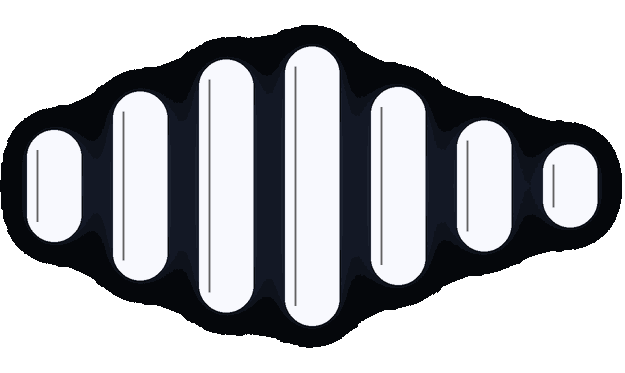

# EvenLouder

<div align="center">
  
  <p><strong>Acoustic Tuning & Loudness Dynamics Processor for Android 15+ (API 35+)</strong></p>
</div>

---

## Overview

**EvenLouder** is an open-source Android audio utility engineered specifically for physical smartphone micro-speakers. 

Instead of multiplying digital sample values (which introduces clipping and triggers aggressive hardware amplifier limiters), EvenLouder uses Android's AIDL-compliant `DynamicsProcessing` architecture to safely enhance perceived loudness, dialogue clarity, and low-end definition.

### Why Typical Volume Boosters Fall Short
- **Excursion Waste:** Miniature smartphone speakers cannot physically reproduce acoustic energy below ~140 Hz ($f_0 \approx 700\text{--}900\text{ Hz}$). Cranked sub-bass wastes amplifier headroom and forces voice-coil over-excursion.
- **SmartPA Limiter Throttling:** Modern smartphone hardware includes dedicated Smart Power Amplifiers (SmartPA) with current/voltage ($I/V$) sensing. Digital signals exceeding $0\text{ dBFS}$ trigger aggressive hardware ducking, resulting in a dull, muffled output.
- **EvenLouder Solution:** Uses high-pass filtering (HPF), Fletcher-Munson presence curve shaping, 3-band dynamic range compression, and a $-0.5\text{ dBFS}$ lookahead brickwall safety limiter.

---

## Key Features

- **AIDL DynamicsProcessing Engine:** Fully compliant with Android 15's 32-band hardware audio effect limitations.
- **12 Calibrated Presets:**
  - *Spatial & Hi-Fi:* Cinema 3D Spatial, Studio Hi-Fi Master, Dynamic Low-End Bass, Tight Transient Bass.
  - *Bass Modes:* Club Bass Punch, Deep Sub-Harmonics, Warm Studio Bass.
  - *Instrumental:* Acoustic & Classical, Concert Symphony Hall, Live Stage & Rock.
  - *Speech & Max:* Dialogue & Voice Max, Ultra Loudroom.
  - *Bypass:* Hardware Bypass for immediate A/B fidelity comparison.
- **Dynamic Session Tracker:** Intercepts active audio playback across players (Spotify, YouTube, VLC, browser) via session listeners.
- **Real-Time Visualizer:** Live interactive frequency response transfer curve.
- **Tactile Sliders:** Precision decibel controls for HPF cutoff, 280 Hz punch, 950 Hz chassis anti-resonance notch, 2.8 kHz vocal clarity, 7.5 kHz treble air, and multi-band compression makeup gain.
- **Notification Deck:** Quick toggle and profile switcher accessible directly from the lock screen and notification tray.
- **Built-in Reference Player:** High-resolution acoustic audio test player built directly into the dashboard.
- **Privacy First:** 100% offline, zero network requests, zero telemetry, zero advertisements.

---

## Documentation

- [User Guide](USER_GUIDE.md): Detailed installation instructions, permissions guide, control breakdown, and troubleshooting.
- [Architecture & DSP Specifications](ARCHITECTURE.md): Signal path schematics, AIDL constraints, and filter stage calibrations.

---

## Installation

Download the latest signed release APK from the [Releases](https://github.com/SatyamPandey001/EvenLouder/releases) section and install it on any device running Android 15+.

---

## Building from Source

```bash
# Clone the repository
git clone https://github.com/SatyamPandey001/EvenLouder.git
cd EvenLouder

# Build release APK
./gradlew assembleRelease

# Run unit tests
./gradlew testDebugUnitTest
```

---

## License

This project is licensed under the Apache License 2.0.
